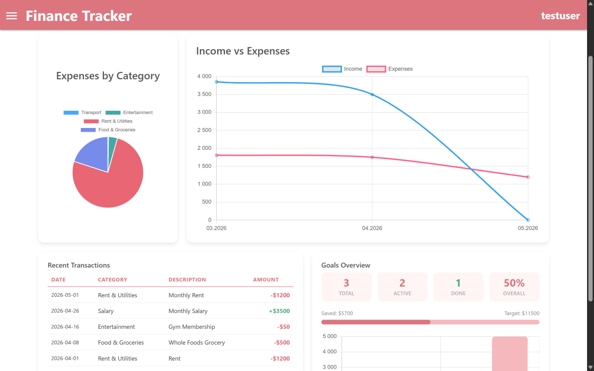
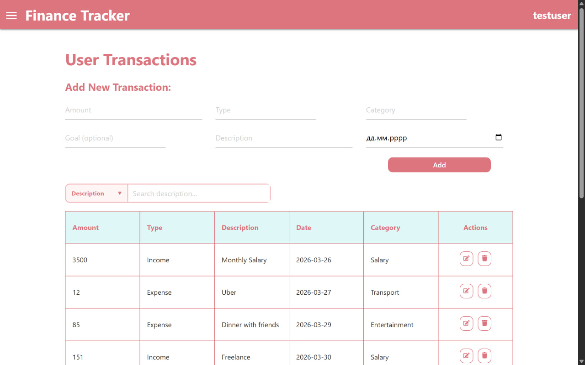
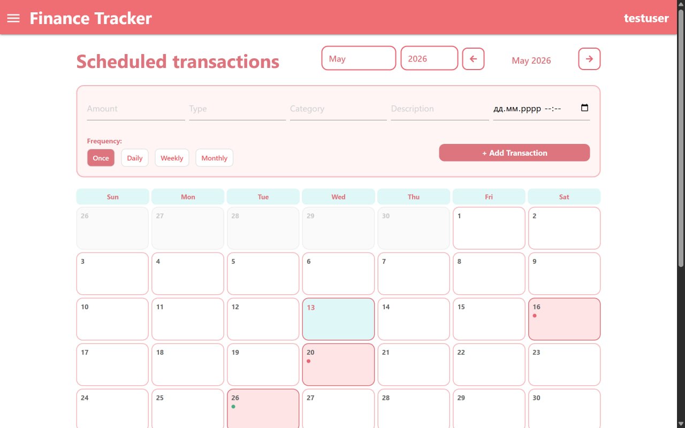
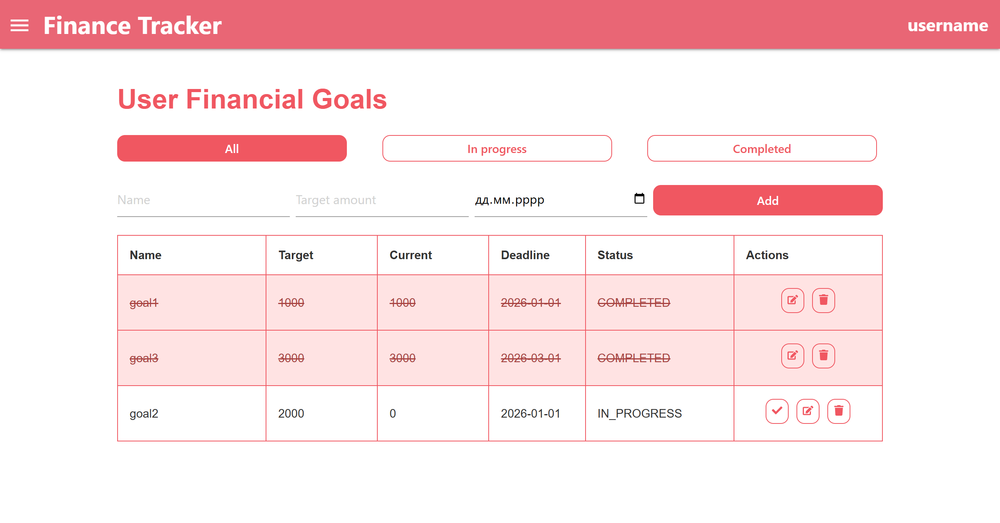
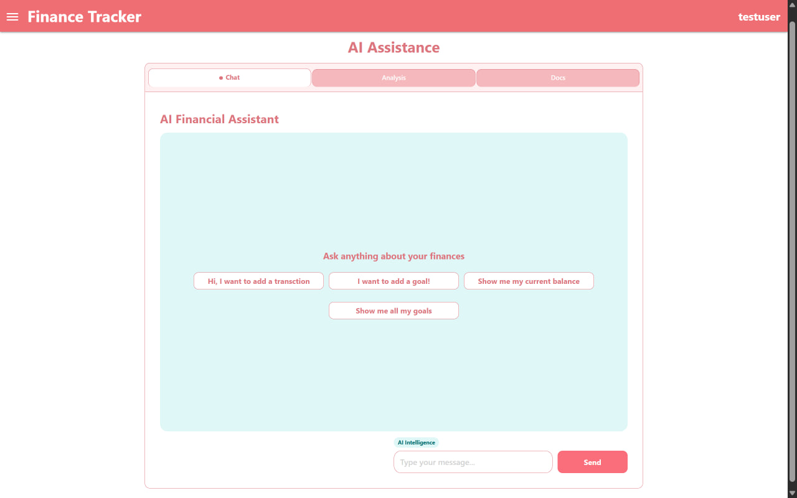
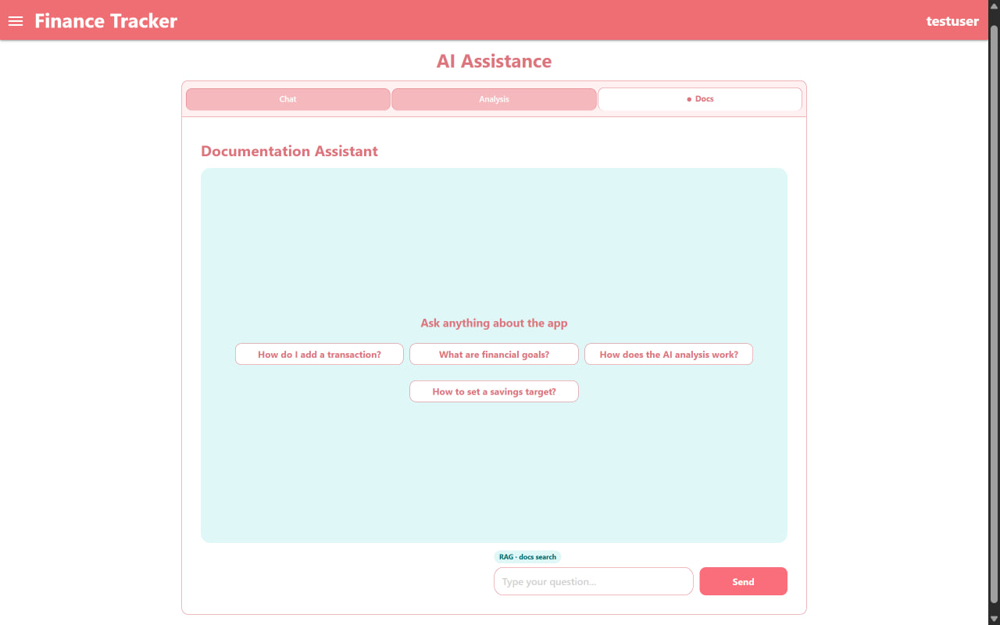
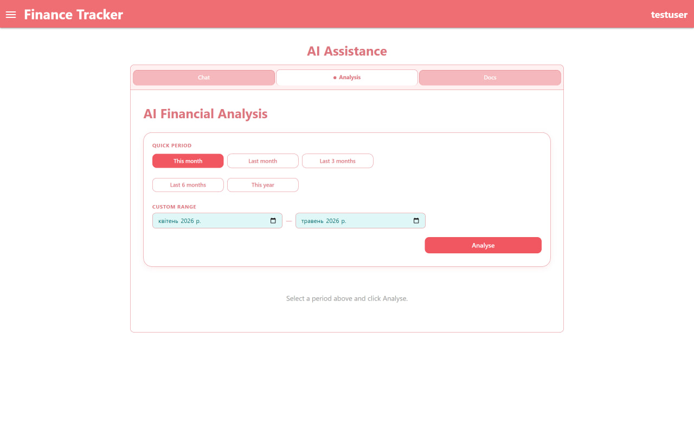
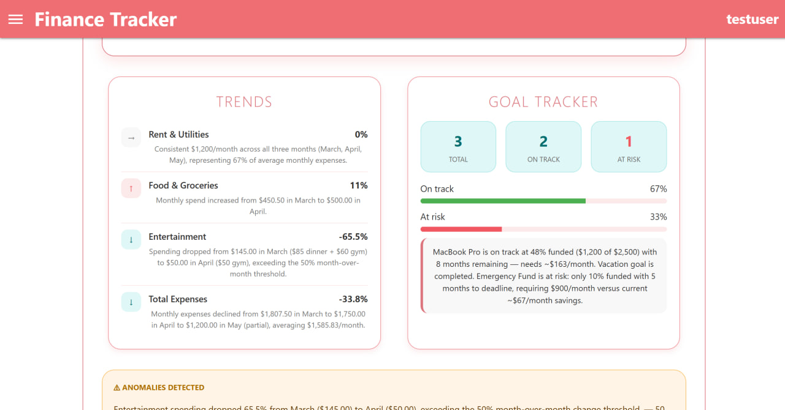
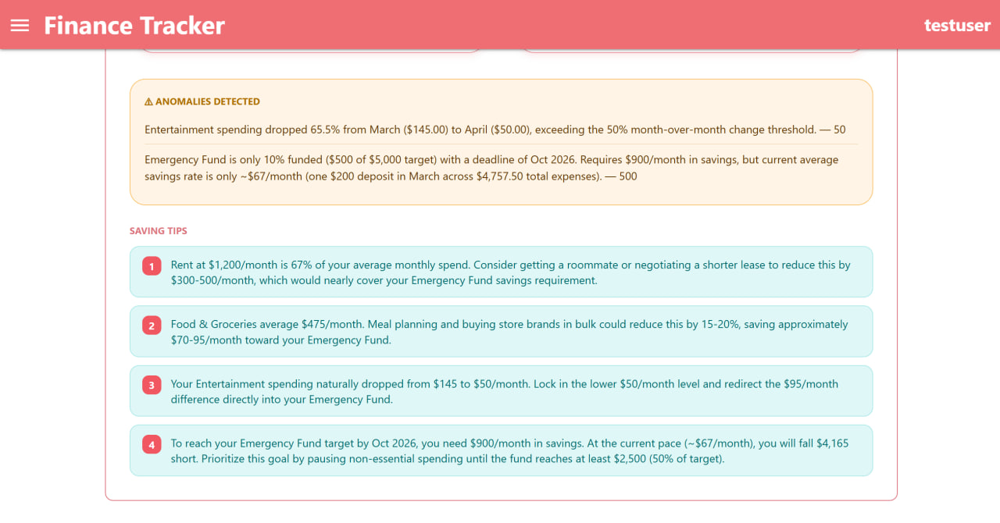

# Personal Finance Tracker System with AI

## Overview

**Personal Finance Tracker System** is an intelligent microservices-based web application designed to help users effectively manage, monitor, and analyze their personal finances. The platform combines modern microservices architecture, asynchronous messaging, vector search, and Large Language Models (LLMs) to provide personalized financial assistance, automated analytics, and natural language interaction.

The application enables users to manage income and expenses, monitor financial goals, schedule recurring transactions, visualize financial statistics, and receive AI-powered recommendations based on their financial behavior.

---

# Features

- User registration and authentication using JWT
- Income and expense management
- Financial goals management
- Scheduled and recurring transactions
- Interactive financial dashboard
- AI-powered financial assistant
- Documentation assistant using RAG
- AI financial analysis and recommendations
- Automatic goal updates through asynchronous messaging
- Semantic search using vector embeddings
- Chat context persistence with Redis

---

# Technology Stack

## Backend

- Java 21
- Spring Boot 3
- Spring Cloud Gateway
- Spring Security
- Spring AI
- Spring Data JPA
- Hibernate
- REST API

## Artificial Intelligence

- Spring AI
- OpenRouter LLM
- Docker Text Embeddings Inference (TEI)
- Retrieval-Augmented Generation (RAG)
- AI Tool Calling
- Vector Search

## Database

- PostgreSQL
- pgvector
- Redis

## Messaging

- RabbitMQ

## Frontend

- React JS
- Axios
- Chart.js / Recharts
- HTML
- CSS3

---

# System Architecture

The application follows a **Microservices Architecture** based on the **Database-per-Service** pattern.

```
                +----------------------+
                |     React Frontend   |
                +----------+-----------+
                           |
                           |
                      API Gateway
                         (8080)
                           |
      -------------------------------------------------
      |              |              |                 |
 User Service   Transaction    Goal Service      AI Service
    (8081)       Service          (8083)           (8084)
                  (8082)
      |              |              |                 |
 PostgreSQL     PostgreSQL     PostgreSQL         PostgreSQL
                                                  + pgvector
                                                      |
                                                    Redis
                                                      |
                                                  RabbitMQ
```

---

# Microservices

## API Gateway (8080)

- JWT authentication
- Request routing
- Security filters
- Centralized entry point

---

## User Service (8081)

Responsible for:

- User registration
- Authentication
- Authorization
- Password encryption
- User profile management

Technologies:

- Spring Security
- JWT
- PostgreSQL

---

## Transaction Service (8082)

Responsible for:

- Income management
- Expense management
- Scheduled transactions
- Recurring transactions
- Categories

Supports:

- Daily transactions
- Weekly transactions
- Monthly transactions
- One-time transactions

---

## Goal Service (8083)

Responsible for:

- Financial goals
- Savings progress
- Goal completion

The service subscribes to RabbitMQ events and automatically updates goal progress whenever relevant financial transactions are created.

---

## AI Service (8084)

The AI Service is the intelligent core of the application.

It integrates:

- Spring AI
- OpenRouter
- RAG
- pgvector
- Redis
- Tool Calling

Main responsibilities:

- AI Chat
- Documentation Assistant
- Financial Analysis
- Semantic Search
- Context Retrieval
- AI Function Calling
- Personalized Recommendations

---

# Artificial Intelligence

## Retrieval-Augmented Generation (RAG)

The application implements a Retrieval-Augmented Generation pipeline to provide accurate and context-aware responses.

### Workflow

1. Documentation is converted into embeddings.
2. Embeddings are stored in PostgreSQL using pgvector.
3. User questions are converted into vectors.
4. Similar vectors are retrieved using semantic search.
5. Relevant context is injected into the LLM prompt.
6. The model generates an accurate response.

### Cosine Similarity


Benefits:

- Reduced hallucinations
- Accurate documentation answers
- Context-aware AI responses

---

## Vector Database

The project uses **pgvector** to store embeddings.

Advantages:

- Fast semantic search
- HNSW indexing
- Efficient nearest-neighbor retrieval
- Native PostgreSQL integration

---

## AI Tool Calling

The AI assistant can understand natural language requests and automatically invoke backend operations.

Examples:

- "Add an expense of \$20 for coffee."
- "Create a savings goal."
- "Show my transactions."
- "Delete my last expense."
- "How much did I spend this month?"

Instead of returning only text, the AI executes the appropriate backend service through Tool Calling.

---

## AI Financial Analysis

The system analyzes historical financial data and generates personalized insights.

Capabilities include:

- Spending trend analysis
- Category distribution
- Income versus expenses
- Financial health evaluation
- Savings recommendations
- Personalized advice

---

## Anomaly Detection

The AI identifies unusual financial behavior.

Examples:

- Sudden increase in restaurant expenses
- Unexpected spending spikes
- Significant month-to-month changes
- Budget overruns

Users receive recommendations to improve financial stability.

---
# Application Screenshots

## Dashboard

The Dashboard provides a quick overview of the user's financial status, including the current balance, recent transactions, savings goals, and interactive charts displaying income and expense trends.

### Features

- Current Balance
- Income & Expense Summary
- Recent Transactions
- Goal Progress
- Pie Chart by Category
- Income vs Expense Line Chart

<p align="center">
  
</p>

---

## Transactions

Users can manage all financial transactions in one place.

### Features

- Add Income
- Add Expense
- Edit Transaction
- Delete Transaction
- Filtering
- Sorting
- Category Management

<p align="center">
  
</p>

---

## Scheduled Transactions

Calendar page for recurring payments and income.

### Features

- Daily Transactions
- Weekly Transactions
- Monthly Transactions
- One-Time Transactions
- Automatic Execution

<p align="center">
  
</p>

---

## Financial Goals

Track personal savings goals and monitor progress.

### Features

- Create Goal
- Edit Goal
- Delete Goal
- Progress Tracking
- Automatic Goal Updates via RabbitMQ

<p align="center">
  
</p>

---

## AI Financial Assistant

Natural language chat powered by Spring AI and OpenRouter.

### Capabilities

- Add transactions
- Create goals
- View balances
- Financial advice
- Tool Calling
- Personalized recommendations

<p align="center">
  
</p>

---

## AI Documentation Assistant

Uses Retrieval-Augmented Generation (RAG) to answer questions about the application.

### Features

- Documentation Search
- Semantic Search
- Context-Aware Responses
- Vector Database (pgvector)

<p align="center">
  
</p>

---

## AI Financial Analysis

Provides automated financial insights and recommendations.

### Features

- Spending Trends
- Income Analysis
- Expense Distribution
- Financial Health Score
- Anomaly Detection
- Savings Recommendations

<p align="center">
  
  
  
</p>

---
